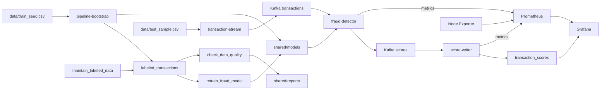

# Fraud Detection Monitoring

Репозиторий содержит решение домашней работы по мониторингу ML-сервиса.

## Архитектура



| Сервис | Описание |
|--------|----------|
| **Kafka** | Топики `transactions` и `scores` для входящих транзакций и результатов скоринга |
| **Kafka UI** | Просмотр сообщений в топиках |
| **transaction-stream** | Непрерывно отправляет строки `test_sample.csv` с новым `transaction_id` и текущим временем |
| **transaction-producer** | Разовая отправка 100 транзакций для проверки |
| **fraud-detector** | Препроцессинг и скоринг моделью из `shared/models`; публикует результат в `scores` |
| **score-writer** | Записывает скор, флаг фрода, версию модели и признаки среза в PostgreSQL |
| **PostgreSQL** | Витрина `labeled_transactions`, состояние `pipeline_state` и результаты `transaction_scores` |
| **pipeline-bootstrap** | Загружает исходную выборку и создает первую модель при запуске |
| **Airflow** | DAG поставки нового месяца, переобучения модели и проверки Data Quality |
| **Prometheus** | Каждую секунду собирает метрики скоринга, записи результатов и Node Exporter |
| **Grafana** | Три дашборда, два правила оповещений и отметка смены версии модели |
| **Node Exporter** | Метрики CPU, памяти, сети и диска |

Общий каталог `shared/models` смонтирован в Airflow как `/opt/airflow/models` и в `fraud-detector` как `/models`. Функции задач находятся в `ml_pipeline/`, файлы в `dags/` связывают их в графы. Отчеты сохраняются в `shared/reports`.

## Требования

- Docker 20.10 или новее;
- Docker Compose 2.0 или новее.

## Быстрый запуск

Скопируйте настройки окружения:

```bash
cp .env.example .env
```

Соберите и запустите сервисы:

```bash
docker compose up -d --build
docker compose ps -a
```

Контейнеры `airflow-permissions`, `airflow-init`, `pipeline-bootstrap` и `kafka-init` должны завершиться со статусом `Exited (0)`. Остальные сервисы должны быть в состоянии `Up`.

После запуска доступны:

- Airflow UI: <http://localhost:8081>, логин `admin`, пароль `admin`;
- Kafka UI: <http://localhost:8082>;
- Grafana: <http://localhost:3000>, логин `admin`, пароль `admin`;
- Prometheus: <http://localhost:9090>;
- PostgreSQL: `localhost:5432`, база `fraud_detection`.

Поток запускается автоматически. Для дополнительной разовой отправки 100 транзакций:

```bash
docker compose --profile manual run --rm transaction-producer
```

## Мониторинг

Дашборды Grafana доступны в каталоге `Fraud monitoring`:

- Обработка транзакций: <http://localhost:3000/d/fraud-scoring>. Транзакции в секунду, P95 времени скоринга, доля мошеннических транзакций, распределение скоров по диапазонам, состав потока по сумме и неверные сообщения;
- Запись результатов: <http://localhost:3000/d/fraud-writer>. Скорость и P95 записи, число выявленных мошеннических транзакций, распределение записанных скоров и таблица по версиям модели;
- Система и срез транзакций: <http://localhost:3000/d/fraud-system>. CPU Utilization, Memory Utilization, Network Traffic, Disk I/O, распределение скоров и TPS с фильтрами по `us_state` и `merch`, доля фрода в последних 1000 транзакций по `cat_id` и средний скор по категориям.

Первые два дашборда используют Prometheus. Третий объединяет системные метрики с SQL-запросами к PostgreSQL.

Метрики скоринга на <http://localhost:8000/metrics>:

- `fraud_scoring_transactions_total` - обработанные транзакции;
- `fraud_scoring_duration_seconds` - время обработки;
- `fraud_scoring_score` - гистограмма скоров;
- `fraud_scoring_fraud_total`, `fraud_scoring_fraud_share` - число и доля фрода;
- `fraud_scoring_model_loads_total{version}` - загрузка версии модели;
- `fraud_scoring_amount_bucket_total{bucket}` - состав потока по суммам;
- `fraud_scoring_invalid_messages_total` - неверные сообщения.

`fraud_scoring_amount_bucket_total` - дополнительная метрика, которой нет в семинарском сервисе. Она показывает изменение состава входящего потока по сумме транзакции на графике «Состав потока по сумме» дашборда обработки.

Метрики записи на <http://localhost:8001/metrics>: `fraud_writer_scores_total`, `fraud_writer_duration_seconds`, `fraud_writer_fraud_total`, `fraud_writer_score`, `fraud_writer_errors_total`. Node Exporter предоставляет метрики CPU, памяти, сети и диска в Prometheus с `job="node-exporter"`.

Проверить, что все три цели Prometheus доступны:

```bash
curl -s 'http://localhost:9090/api/v1/targets' | python3 -m json.tool
```

Убедиться, что счетчик растет на живом потоке:

```bash
curl -s 'http://localhost:8000/metrics' | grep '^fraud_scoring_transactions_total'
sleep 10
curl -s 'http://localhost:8000/metrics' | grep '^fraud_scoring_transactions_total'
```

## Оповещения и смена модели

Правила автоматически появляются в Grafana: `Alerting` -> `Alert rules` -> `Fraud monitoring`.

- `Поток транзакций остановился`: меньше одной обработанной операции за минуту в течение 30 секунд. Для проверки выполните `docker compose stop transaction-stream`, подождите до 90 секунд и запустите `docker compose start transaction-stream`.
- `Скоринг обрабатывает транзакции медленно`: P95 времени обработки выше 0.5 секунды в течение 30 секунд. Для проверки можно временно снизить порог в `grafana/provisioning/alerting/rules.yml` до `0.000001`, перезапустить Grafana и затем вернуть значение `0.5`.

Отметка смены модели появляется на дашборде обработки после загрузки новой версии без перезапуска сервиса. Запустите DAG `maintain_labeled_data`, затем `retrain_fraud_model` в Airflow и проверьте `shared/models/latest.json`. Если кандидат прошел контроль качества, отправьте новые транзакции и откройте график скоринга: аннотация `Скоринг перешёл на <version>` показывает новую серию `fraud_scoring_model_loads_total{version}`. Версия также видна в таблице PostgreSQL на дашборде записи.

## Проверка данных

Последние результаты скоринга:

```bash
docker compose exec postgres psql \
  -U pipeline_user -d fraud_detection \
  -c "SELECT transaction_id, score, fraud_flag, model_version, created_at FROM transaction_scores ORDER BY created_at DESC LIMIT 10;"
```

Количество строк по версиям модели:

```bash
docker compose exec postgres psql \
  -U pipeline_user -d fraud_detection \
  -c "SELECT model_version, COUNT(*) FROM transaction_scores GROUP BY model_version ORDER BY model_version;"
```

Количество строк по месяцам размеченной витрины:

```bash
docker compose exec postgres psql \
  -U pipeline_user -d fraud_detection \
  -c "SELECT batch_month, COUNT(*) FROM labeled_transactions GROUP BY batch_month ORDER BY batch_month;"
```

Список топиков Kafka:

```bash
docker compose exec kafka /opt/kafka/bin/kafka-topics.sh \
  --bootstrap-server kafka:29092 --list
```

## Проверка DAG

DAG доступны в Airflow UI и запускаются по расписанию раз в 5 минут. Для всех DAG установлено `catchup=False`.

Добавьте следующий месяц в витрину:

```bash
docker compose exec airflow-scheduler \
  airflow dags trigger maintain_labeled_data
```

Запустите переобучение:

```bash
docker compose exec airflow-scheduler \
  airflow dags trigger retrain_fraud_model
```

Запустите проверку качества данных:

```bash
docker compose exec airflow-scheduler \
  airflow dags trigger check_data_quality
```

Проверить состояние запусков можно в Airflow UI или командой:

```bash
docker compose exec airflow-scheduler \
  airflow dags list-runs -d retrain_fraud_model --no-backfill
```

Проверка ошибок импорта:

```bash
docker compose exec airflow-scheduler airflow dags list-import-errors
```

## Переобучение модели

DAG `retrain_fraud_model` содержит последовательность задач:

```text
resolve_training_window -> prepare_training_data -> train_candidate
-> evaluate_candidate -> publish_candidate -> advance_training_state
```

Параметры контура:

- окно обучения содержит 3 календарных месяца;
- первые 2 месяца используются для train, последний месяц - для test;
- ежемесячный батч содержит до 5 000 строк;
- глубина хранения витрины составляет 12 месяцев;
- inference и обучение выполняются на CPU.

Повторный запуск `maintain_labeled_data` использует детерминированные UUID. Указатель `last_trained_month` обновляется только после успешного сохранения модели. Если следующий месяц еще не сформирован, запуск переобучения завершается без ошибки со статусом `skipped` для задач, которым не хватает данных.

Опубликованные модели:

```bash
ls -la shared/models
```

Текущее состояние окна обучения:

```bash
docker compose exec postgres psql \
  -U pipeline_user -d fraud_detection \
  -c "SELECT * FROM pipeline_state;"
```

## Проверка качества модели

Основная метрика - ROC-AUC на самом свежем месяце окна. Если значение ниже метрики текущей production-модели, новый файл не публикуется и указатель месяца не изменяется. Дополнительно рассчитываются Average Precision и F1.

## Data Quality

DAG `check_data_quality` проверяет:

- наличие строк в витрине;
- уникальность `transaction_id`;
- значения `target` из `{0, 1}`;
- заполненность и неотрицательность `amount`;
- заполненность `transaction_time`;
- непрерывность календарных месяцев;
- допустимые диапазоны широты и долготы;
- заполненность `cat_id` и `us_state`.

HTML-отчеты сохраняются в `shared/reports`. Актуальный отчет доступен в `shared/reports/latest.html`.

## Preprocessing

Общий модуль `common/features.py` используется при обучении и скоринге. В нем реализованы:

- логарифмирование суммы, населения города и расстояния;
- расчет расстояния Haversine между клиентом и продавцом;
- циклические признаки часа и дня недели;
- признак выходного дня;
- обработка неизвестных категорий с `OneHotEncoder`;
- заполнение числовых пропусков и стандартизация.

Для классификации используется `LogisticRegression` с балансировкой классов.

## Тесты

```bash
python3.12 -m venv .venv
source .venv/bin/activate
pip install -r requirements.txt
python3 -m unittest discover -s tests -v
```

## Структура проекта

```text
.
├── airflow/
│   ├── Dockerfile
│   └── requirements.txt
├── common/
│   └── features.py
├── dags/
│   ├── check_data_quality.py
│   ├── maintain_labeled_data.py
│   └── retrain_fraud_model.py
├── data/
│   ├── test_sample.csv
│   └── train_seed.csv
├── database/
│   └── init.sql
├── fraud_detector/
├── grafana/
│   ├── dashboards/
│   └── provisioning/
├── ml_pipeline/
├── prometheus/
├── score_writer/
├── shared/
│   ├── models/
│   └── reports/
├── transaction_producer/
├── tests/
├── docker-compose.yml
├── requirements.txt
└── README.md
```

## Остановка

Остановить контейнеры:

```bash
docker compose down
```

Удалить контейнеры вместе с данными Kafka, PostgreSQL и Airflow:

```bash
docker compose down -v
```
